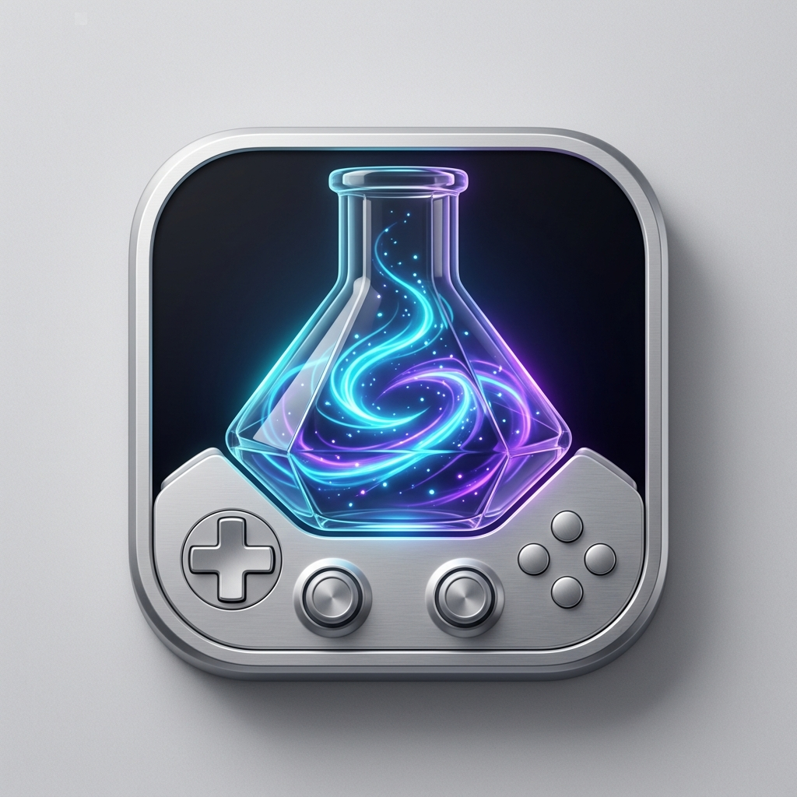

# Ravlator — Windows Gaming & Wine Prefix Manager for macOS

<p align="center">
  
</p>

<p align="center">
  <b>Next-Generation Windows Gaming & Wine Prefix Environment Manager tailored for Apple Silicon macOS.</b><br>
  Inspired by Linux's <i>Bottles</i>, built natively with Python, PySide6 (Qt 6), and Game Porting Toolkit 2 (GPTK 2).
</p>

<p align="center">
  
  
  
  
  
  
</p>

---

## 🎮 Overview

**Ravlator** is an open-source, modular Windows gaming environment manager for macOS. It allows gamers and developers on Apple Silicon Macs (M1/M2/M3/M4) to effortlessly create, isolate, optimize, and manage sandboxed Wine prefixes ("bottles") without manual terminal configuration or prefix pollution.

Ravlator bridges the gap between raw Wine/GPTK translation layers and modern macOS design, providing a clean Apple Human Interface Guidelines (HIG) light interface, a powerful decoupled headless core, and an exhaustive CLI tool.

---

## ✨ Key Features

### 🍾 Prefix & Bottle Lifecycle
- **Isolated Sandboxes:** Create independent 64-bit Wine prefixes (`WINEARCH=win64`) with dedicated `drive_c`, registry hives, and isolated user profiles.
- **Environment Presets:** One-click configurations for **Gaming** (MSync, D3DMetal, High-DPI), **Productivity** (WineD3D, standard synchronization), and **Custom**.
- **Windows Version Emulation:** Switch on the fly between **Windows 10**, **Windows 11**, and legacy **Windows 7** compatibility modes.
- **Atomic Operations:** Prefix creation, deletion, cloning, and resets are atomic, ensuring zero corruption in `~/Library/Application Support/Ravlator/`.

### ⚡ Apple Silicon Graphics & Performance
- **Darwin Mach Synchronization (MSync):** Native mach semaphore synchronization (`WINEMSYNC=1`) eliminating multithreaded lock contention.
- **Apple Metal Performance HUD:** Real-time hardware overlay displaying live FPS, frametimes, GPU draw calls, and unified memory usage (`MTL_HUD_ENABLED=1`).
- **Retina High-DPI Resolution Mode:** Crisp rendering at native Retina display pixel density with Windows DPI virtualization.
- **DXVK Diagnostics HUD:** Configurable DirectX-to-Vulkan overlay metrics.
- **Emulated Virtual Desktop:** Run legacy games that fail in fullscreen mode inside contained, fixed-resolution desktop viewports.

### 🏪 Game Store Deployments & Shortcut Generation
- **Guided Store Setup:** Guided installation of official Windows client installers for **Steam**, **Epic Games Launcher**, **GOG Galaxy**, **EA App**, and **Battle.net**.
- **Auto-Detection & Stability Injection:** Automatic scanning of Drive C: and instant injection of mandatory Chromium Embedded Framework stability parameters (`-no-cef-sandbox -cef-disable-gpu -noverifyfiles -allossearch`) for Steam.
- **Native Steam Login Cache Sync:** 1-click credential synchronization from native macOS Steam (`config.vdf`, `loginusers.vdf`, `registry.vdf`, `userdata`) to log in seamlessly without CEF web login errors.
- **Standalone macOS `.app` Bundles:** Generate self-contained, double-clickable macOS applications on your Desktop, complete with PE icons extracted directly from Windows `.exe` binaries.

### 📦 Dependencies Catalog & Winetricks
- **Curated Gaming Runtimes:** One-click installation of Microsoft Visual C++ (2010 to 2022), DirectX 9.0c, Microsoft .NET Framework 4.8, Wine Mono, DirectPlay, OpenAL, and PhysX.
- **Declarative Community Recipes:** Expandable via standard `.json` and `.yaml` declarative recipe manifests.
- **Clean Dependency Uninstaller:** Safely unregister dependencies and automatically revert associated `WINEDLLOVERRIDES`.
- **Winetricks Terminal Integration:** Built-in runner and Homebrew winetricks discovery with isolated execution in macOS `Terminal.app`.

### 🛡️ Safety, Portability & Cloud Sync
- **Host Filesystem Sandbox Isolation:** Protects the macOS host by sandboxing Wine drive `Z:` to `drive_c`, preventing Windows executables, malware, or ransomware from traversing and modifying macOS host files (`/`, `/Users`, `/Library`).
- **Zip Slip & Tar Slip Hardening:** Path traversal validation on all imported `.zip` and `.tar.gz` bottle archives, blocking malicious relative escapes (`../`).
- **Shell Injection Immunity:** Strict `shlex.quote` tokenization across `.app` desktop bundle launchers and Terminal winetricks scripts.
- **Enforced TLS/HTTPS Transport:** Mandates encrypted HTTPS connections for all CDN runner downloads and dependency recipes.
- **Kernel Anti-Cheat Detection:** Pre-launch heuristic scan warning users of incompatible Windows kernel drivers (EasyAntiCheat, BattlEye, Riot Vanguard, Ricochet, GameGuard, Xigncode3).
- **Rolling Registry Backups:** Automatic pre-launch backups (`system.reg.bak`, `user.reg.bak`) preventing registry corruption.
- **Point-in-Time Snapshots:** Instant snapshots and state rollback before modifying configurations or installing untested mods.
- **Cross-Device Cloud Saves:** Automated symlinking of `Saved Games` and `Documents/My Games` into **iCloud Drive**, **Google Drive**, **OneDrive**, or **Dropbox**.
- **Archive Import & Export:** Package bottles into compressed `.tar.gz` or `.zip` archives with dynamic symlink restoration.

---

## 🏗️ Architecture

Ravlator is engineered following strict **Clean Architecture** and **Headless Decoupling** principles:

```
ravlator/
├── core/                  # Headless Core Engine (ZERO PySide6 / GUI imports)
│   ├── bottle.py          # Prefix lifecycle, atomic creation, registry backups
│   ├── runner.py          # Wine/GPTK runner management & checksum verification
│   ├── process.py         # WineEnvironmentBuilder & async process management
│   ├── anticheat.py       # Kernel driver heuristic detection engine
│   ├── cloud_saves.py     # macOS cloud storage symlink synchronization
│   ├── dependencies.py    # Declarative YAML/JSON recipe installer & uninstaller
│   ├── tools.py           # winecfg, regedit, winetricks terminal runner
│   ├── portability.py     # Tar/Zip bottle import/export
│   ├── snapshots.py       # Differential point-in-time snapshot manager
│   ├── stores.py          # Steam, Epic Games, GOG installers
│   ├── telemetry.py       # Process monitoring & log streaming
│   └── diagnostics.py     # Apple Silicon, Rosetta 2, SIP, Metal diagnostics
├── gui/                   # macOS Presentation Layer (PySide6 / Qt 6)
│   ├── main_window.py     # 4-Tab Bottle Manager (macOS HIG Light Theme)
│   ├── views/             # Dialogs (Runners, Dependencies, Snapshots, Stores, etc.)
│   └── utils/icons.py     # Retina dynamic Lucide SVG vector icon renderer
└── cli/
    └── main.py            # Complete headless command-line interface (ravlator-cli)
```

---

## 🚀 Installation & Requirements

### System Requirements
- **Hardware:** Apple Silicon Mac (M1, M2, M3, M4 series; Base, Pro, Max, Ultra).
- **Operating System:** macOS 14.0 Sonoma or macOS 15.0+ Sequoia.
- **Python Version:** Python 3.12 or newer.
- **Rosetta 2:** Required for x86_64 translation (`softwareupdate --install-rosetta`).

### Setup Instructions

1. **Clone the repository:**
   ```bash
   git clone https://github.com/your-username/ravlator.git
   cd ravlator
   ```

2. **Create and activate a virtual environment:**
   ```bash
   python3 -m venv .venv
   source .venv/bin/activate
   ```

3. **Install dependencies:**
   ```bash
   pip install -e .
   ```

4. **Launch the Graphical Application:**
   ```bash
   python -m ravlator
   # Or directly:
   ravlator
   # Or:
   python -m ravlator.gui.main_window
   ```

---

## 💻 CLI Usage (`ravlator-cli`)

Ravlator provides a first-class headless CLI for terminal power users and automation scripts:

```bash
# List all configured bottles
python -m ravlator.cli.main list-bottles

# Create a new gaming prefix
python -m ravlator.cli.main create-bottle "CyberpunkBottle" --preset gaming --version win10

# Download and install a verified runner from GitHub CDN
python -m ravlator.cli.main install-runner gptk-2.0

# Deploy Steam into the bottle
python -m ravlator.cli.main install-store --bottle "CyberpunkBottle" --store steam

# Install Visual C++ 2022 runtime
python -m ravlator.cli.main install-dependency --bottle "CyberpunkBottle" --dep vcredist2022

# Launch a Windows executable
python -m ravlator.cli.main run --bottle "CyberpunkBottle" --exe "/path/to/game.exe"

# Create a standalone macOS .app bundle on Desktop
python -m ravlator.cli.main create-shortcut --bottle "CyberpunkBottle" --exe "/path/to/game.exe" --name "MyGame"

# Enable iCloud Drive game save synchronization
python -m ravlator.cli.main cloud-sync --bottle "CyberpunkBottle" --enable --provider "iCloud Drive"

# Create a point-in-time snapshot
python -m ravlator.cli.main snapshot-create --bottle "CyberpunkBottle" --name "PreModBackup"

# Export bottle as portable archive
python -m ravlator.cli.main export-bottle --bottle "CyberpunkBottle" --out ~/Downloads/my_bottle.tar.gz

# Graceful stop or force kill
python -m ravlator.cli.main stop-bottle "CyberpunkBottle"   # wineboot -s
python -m ravlator.cli.main kill-bottle "CyberpunkBottle"   # wineserver -k
```

---

## 🧪 Testing & Verification

Ravlator maintains a comprehensive unit test suite covering core operations, process managers, portable archives, anti-cheat detection, and cloud synchronization:

```bash
# Run all unit tests
.venv/bin/python -m unittest discover -s tests
```

---

## 📄 Documentation

The complete, formal ISO/IEC/IEEE 29148 system requirements specification is available in:
- [`docs/SRS_Documentation.md`](docs/SRS_Documentation.md)

---

## 🎨 Iconography & Attribution

- **Icons:** [Lucide Icons](https://lucide.dev/) (ISC License). Vector SVGs rendered dynamically with Retina support and macOS Light Theme tints.
- **Runtimes:** [WineHQ](https://www.winehq.org/) & Apple [Game Porting Toolkit](https://developer.apple.com/games/).

---

## ⚖️ License

Distributed under the MIT License. See `LICENSE` for more information.
