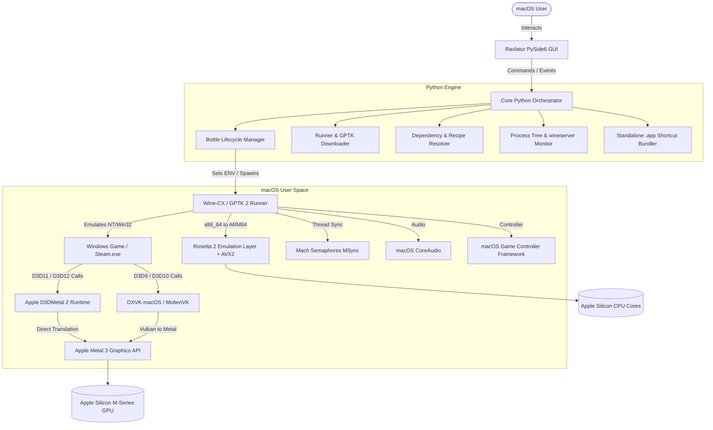
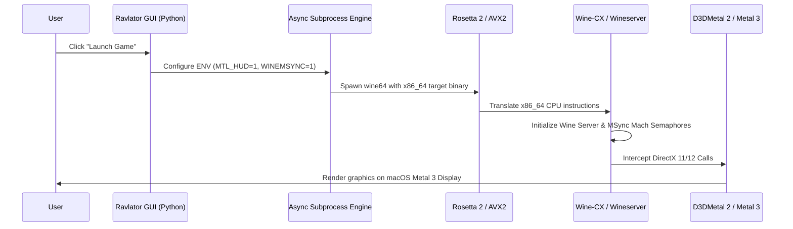

# Software Requirements Specification (SRS)
## Project: Ravlator — Next-Generation Windows Gaming & Prefix Manager for macOS
**Document Version:** 1.0.0  
**Status:** Approved / Architecture Baseline  
**Standard:** ISO/IEC/IEEE 29148:2018 Compliant  
**Target Platform:** macOS 14.0+ (Sonoma), macOS 15.0+ (Sequoia) on Apple Silicon (M1/M2/M3/M4/M5)  
**Implementation Language:** Python 3.12+ (PySide6 / Qt 6 UI + Asynchronous Darwin Process Subsystem)

---

## Table of Contents
1. [Document Information & Revisions](#1-document-information--revisions)
2. [Executive Summary](#2-executive-summary)
3. [Section 1: Introduction](#section-1-introduction)
   - 1.1 Purpose
   - 1.2 Scope of the System
   - 1.3 Definitions, Acronyms, and Abbreviations
   - 1.4 References
   - 1.5 Document Conventions
4. [Section 2: Overall Description](#section-2-overall-description)
   - 2.1 Product Perspective & Comparative Analysis
   - 2.2 System Architecture Overview
   - 2.3 Product Functions Overview
   - 2.4 User Classes and Personas
   - 2.5 Operating Environment & Hardware Requirements
   - 2.6 Design and Implementation Constraints
   - 2.7 Assumptions and Dependencies
5. [Section 3: System Architecture & Subsystem Decomposition](#section-3-system-architecture--subsystem-decomposition)
   - 3.1 Architectural Decomposition Diagram
   - 3.2 Subsystem 1: GUI Presentation Layer (PySide6)
   - 3.3 Subsystem 2: Core Orchestration Engine
   - 3.4 Subsystem 3: Bottle / Prefix Lifecycle Manager
   - 3.5 Subsystem 4: Runner & Graphics Translation Stack
   - 3.6 Subsystem 5: Dependency & Runtime Resolution Engine
   - 3.7 Subsystem 6: Process Monitor, Telemetry & Crash Logger
   - 3.8 Subsystem 7: Launcher, Shortcuts & Native macOS App Generator
6. [Section 4: Detailed Functional Requirements](#section-4-detailed-functional-requirements)
   - 4.1 Bottle (Prefix) Lifecycle Management (FR-01 to FR-06)
   - 4.2 Runner & Engine Management (FR-07 to FR-11)
   - 4.3 Graphics Translation & Synchronization (FR-12 to FR-16)
   - 4.4 Automated Dependency & Runtime Manager (FR-17 to FR-20)
   - 4.5 Executable Execution & macOS Shortcut Bundler (FR-21 to FR-25)
   - 4.6 Game Store Integration & CEF Workarounds (FR-26 to FR-28)
   - 4.7 Task Management, Process Trees & Wine Control (FR-29 to FR-32)
   - 4.8 Snapshot, Backup & Portability Engine (FR-33 to FR-36)
7. [Section 5: External Interface Requirements](#section-5-external-interface-requirements)
   - 5.1 User Interfaces (macOS Human Interface Guidelines)
   - 5.2 Hardware Interfaces (Apple Silicon GPU & Gamepads)
   - 5.3 Software Interfaces (Darwin Kernel, Rosetta 2, Wine Server Socket)
   - 5.4 Communications Interfaces (HTTPS Content Delivery)
8. [Section 6: Non-Functional Requirements](#section-6-non-functional-requirements)
   - 6.1 Performance & Latency Requirements
   - 6.2 Reliability & Fault Tolerance
   - 6.3 Security, Privacy & Gatekeeper Compliance
   - 6.4 Usability & Human Factors
   - 6.5 Maintainability, Modularity & Extensibility
9. [Section 7: Python Technology Stack & Implementation Specifications](#section-7-python-technology-stack--implementation-specifications)
   - 7.1 Language & Virtual Environment
   - 7.2 UI Architecture (PySide6 / QML / QtWidgets)
   - 7.3 Concurrency Model (`asyncio` + `QThread`)
   - 7.4 Subprocess Execution & Environment Management
   - 7.5 Binary Packaging, Code Signing & Notarization
10. [Section 8: Risk Analysis & Mitigation Strategies](#section-8-risk-analysis--mitigation-strategies)
11. [Section 9: Development Roadmap & Milestones](#section-9-development-roadmap--milestones)
12. [Section 10: Appendices](#section-10-appendices)
    - Appendix A: Complete Wine Environment Variable Matrix
    - Appendix B: Steam CEF Crash Mitigation Profile
    - Appendix C: Wine Prefix Directory Structure on macOS

---

## 1. Document Information & Revisions

| Version | Date | Author / Role | Summary of Changes |
| :--- | :--- | :--- | :--- |
| **1.0.0** | 2026-11-18 | System Architecture Team | Initial baseline specification of Ravlator for macOS. Comprehensive ISO/IEC/IEEE 29148 SRS. |

---

## 2. Executive Summary

**Ravlator** is an open-source graphical environment manager designed specifically for macOS (Apple Silicon), engineered to orchestrate and streamline the execution of Microsoft Windows x86_64 gaming applications without requiring a hypervisor or full Windows virtual machine.

Inspired by the workflow and compartmentalization of **Bottles** on Linux, Ravlator brings bottle-based sandboxing, multi-runner switching, one-click dependency installation, and fine-grained DLL overrides to macOS. Built on **Python 3.12+** and **PySide6 (Qt 6)**, Ravlator integrates modern macOS compatibility frameworks:
- **Apple Game Porting Toolkit 2 (GPTK 2)** featuring **D3DMetal 2** (DirectX 11/12 to Metal 3) and **Metal Shader Converter**.
- **macOS Sequoia AVX2 Instruction Set Emulation** via updated Rosetta 2.
- **Hardware-accelerated Ray Tracing** translation on Apple M3/M4+ hardware.
- **MSync (Mach Semaphore Synchronization)** for low-latency thread coordination.
- **DXVK-macOS & MoltenVK** as fallback translation layers for DirectX 9/10/11 titles.

Ravlator bridges the gap left by discontinued or legacy frontends (e.g., archived Whisky, older Wineskin/PlayOnMac), delivering a sustainable, maintainable Python architecture with a native macOS aesthetic.

---

## Section 1: Introduction

### 1.1 Purpose
This document establishes the Software Requirements Specification (SRS) for **Ravlator**. It defines both functional and non-functional requirements, software architecture, subsystem designs, external interfaces, and implementation constraints. This document serves as the primary technical contract for software engineers, UX designers, QA testers, and open-source contributors.

### 1.2 Scope of the System
Ravlator is a desktop application written in Python targeting macOS on Apple Silicon. The application will:
1. Provide an intuitive graphical interface to create, clone, configure, back up, and destroy isolated Wine environments ("Bottles").
2. Manage downloads, installations, and dynamic switching of execution engines ("Runners"), including Wine-CX, Apple GPTK 1.x/2.x, and custom community builds.
3. Automatically install gaming dependencies (Microsoft Visual C++ Redistributables, .NET Frameworks, DirectX runtimes, CoreFonts, PhysX) via curated recipes.
4. Provide single-click toggles for macOS graphics optimizations: Apple Metal Performance HUD, MSync, ESync, Retina High-DPI scaling, and DXVK.
5. Manage game store clients (Steam, Epic Games, GOG Galaxy, Battle.net) with integrated workarounds for known translation bottlenecks (such as Steam Chromium Embedded Framework crashes).
6. Generate standalone macOS `.app` bundle shortcuts on the Desktop or in `~/Applications` that invoke games directly through their configured bottle.

**Exclusions from Scope:**
- Kernel-level anti-cheat drivers (e.g., Riot Vanguard, BattlEye kernel mode, Easy Anti-Cheat kernel mode, Denuvo Anti-Tamper kernel level) that require ring-0 Windows kernel execution are outside the capability of user-space Wine translation layers and will not be supported.
- Ravlator does not distribute proprietary, copyrighted game assets or unauthorized Apple proprietary binaries; it downloads public artifacts or extracts authorized local toolkit components.

### 1.3 Definitions, Acronyms, and Abbreviations

| Term / Acronym | Definition |
| :--- | :--- |
| **Bottle** | An isolated `WINEPREFIX` directory containing a virtual Windows C: drive, registry hives, and isolated configuration settings. |
| **Runner** | A compiled Wine binary distribution (e.g., Wine-CX, GPTK Wine) responsible for translating Windows Win32/NT APIs into POSIX system calls. |
| **GPTK / GPTK 2** | Apple Game Porting Toolkit (versions 1 and 2), Apple's SDK combining modified Wine, D3DMetal, and Metal Shader Converter. |
| **D3DMetal** | Apple's proprietary dynamic library (`libd3dshared.dylib`, `libd3d12.dylib`) translating DirectX 11 and DirectX 12 calls directly to Apple Metal. |
| **DXVK** | Direct3D 9/10/11 translation layer converting DirectX calls to Vulkan API calls. |
| **MoltenVK** | Open-source Vulkan implementation layered over Apple Metal on macOS. |
| **MSync** | Mach Semaphore synchronization; a Darwin-native thread synchronization primitive developed by CodeWeavers to replace high-overhead `wineserver` locking. |
| **ESync** | Eventfd-based synchronization mechanism (emulated via pipes on macOS; superseded by MSync). |
| **Rosetta 2** | Apple's dynamic binary translator enabling ARM64 Apple Silicon processors to execute x86_64 machine instructions. |
| **AVX2** | Advanced Vector Extensions 2; 256-bit SIMD instruction set emulated on Apple Silicon starting in macOS 15 Sequoia via Rosetta 2. |
| **CEF** | Chromium Embedded Framework; the web view engine powering the Steam client UI, notorious for crashing under Wine without specific flags. |
| **TCC** | Transparency, Consent, and Control; macOS security framework regulating disk, accessibility, and input monitoring access. |
| **PySide6** | The official Python binding for Qt 6, providing cross-platform GUI, threading, and multimedia capabilities. |

### 1.4 References
1. *ISO/IEC/IEEE 29148:2018 Systems and software engineering — Life cycle processes — Requirements engineering.*
2. *Apple Developer Documentation: Game Porting Toolkit 2 & Metal 3 Specifications (WWDC 2024).*
3. *CodeWeavers CrossOver Source Code & MSync Implementation Documentation.*
4. *WineHQ Developer Documentation & Win32 API Specification.*
5. *Bottles (Linux) Documentation & Architecture Repository (usebottles.com).*
6. *Apple Human Interface Guidelines (HIG) for macOS Desktop Applications.*

### 1.5 Document Conventions
- Requirements are tagged with unique identifiers: `FR-xx` for Functional Requirements and `NFR-xx` for Non-Functional Requirements.
- The keywords **SHALL** (mandatory), **SHOULD** (recommended), and **MAY** (optional) follow RFC 2119 standards.

---

## Section 2: Overall Description

### 2.1 Product Perspective & Comparative Analysis

```
+-------------------------------------------------------------------------+
|                              Ravlator                                   |
|   (Modern Python 3.12 + PySide6 UI / Async Subsystem / Native macOS)   |
+-------------------------------------------------------------------------+
       |                                                    |
       v                                                    v
+-------------------------------+             +---------------------------+
|  Bottles (Linux Inspiration)  |             |  Whisky (macOS Benchmark) |
|  - Python + GTK4 / Libadwaita |             |  - Swift + SwiftUI        |
|  - Linux namespaces/Flatpak   |             |  - Tailored to GPTK 1/2   |
|  - Proton-GE / Wine-GE        |             |  - Archived mid-2024      |
|  - DXVK / VKD3D-Proton        |             |  - Limited Dependency GUI |
+-------------------------------+             +---------------------------+
```

| Feature / Metric | Bottles (Linux) | Whisky (macOS) | CrossOver (macOS) | **Ravlator (This Project)** |
| :--- | :--- | :--- | :--- | :--- |
| **Target OS** | Linux (Flatpak/Native) | macOS 14+ | macOS 10.15 - 15+ | **macOS 14+ / 15+ (Sequoia)** |
| **Core Language** | Python + GTK4 | Swift + SwiftUI | C / Objective-C / Python | **Python 3.12 + PySide6 (Qt 6)** |
| **Graphics Stack** | DXVK / VKD3D / Vulkan | D3DMetal (GPTK) | D3DMetal / DXVK-macOS | **D3DMetal 2, DXVK, DXMT, WineD3D** |
| **DX12 Support** | Full (VKD3D-Proton) | Yes (D3DMetal) | Yes (D3DMetal) | **Yes (D3DMetal 2 + Ray Tracing)** |
| **AVX2 Support** | Native (x86_64 CPU) | macOS 15+ (GPTK 2) | macOS 15+ (CrossOver 24) | **Automated detection & flags (macOS 15+)** |
| **Dependencies** | Automated Repository | Manual Winetricks CLI | Curated Installers | **Integrated GUI Dependency Manager** |
| **CEF Steam Fix** | Handled natively | Manual user flags | Built-in custom wine patch | **Automated injection & profile fix** |
| **Maintenance** | Active | Archived | Commercial ($64/yr) | **Open-source & Community Sustained** |

### 2.2 System Architecture Overview

Ravlator acts as a central coordinator between macOS user space, the Apple Silicon hardware translation layers, and the underlying Wine prefix.



### 2.3 Product Functions Overview
1. **Bottle Provisioning & Presets:** Rapid creation of isolated `WINEPREFIX` directories using optimized configuration templates:
   - *Gaming Preset:* MSync enabled, D3DMetal 2 enabled, Metal Performance HUD toggleable, Retina HiDPI configured.
   - *Application Preset:* WineD3D/DXVK enabled, standard sync, focus on low CPU idle usage.
   - *Custom Preset:* User-defined runners, DLL overrides, and synchronization options.
2. **Runner Management:** Automated downloading, checksum verification, unpacking, and dynamic assignment of Wine runners (Wine-CX, GPTK 2).
3. **One-Click Dependency Installation:** Modular JSON/YAML recipe-based installation of common Windows runtimes:
   - Visual C++ 2005 through 2022 runtimes (x86 and x64).
   - Microsoft .NET Framework (Wine-Mono, .NET 4.8, .NET 6/7/8 Desktop Runtimes).
   - DirectX End-User Runtimes (June 2010), DirectPlay, XInput, OpenAL, PhysX.
4. **macOS Integration:**
   - Standalone `.app` generator: packages games into clickable macOS application bundles in `~/Applications` with extracted Windows icons.
   - Full support for the Apple Metal Performance HUD overlay (`MTL_HUD_ENABLED=1`).
   - Retina display High-DPI switching (`WINE_DPI_AWARE`).
5. **Process & Crash Management:**
   - Real-time display of running Windows processes inside any active bottle.
   - Single-click graceful stop (`wineboot -s`), reboot (`wineboot -r`), or emergency force kill (`wineserver -k`).
   - Integrated crash log viewer aggregating `stdout`/`stderr` and Wine debug channels (`WINEDEBUG`).

### 2.4 User Classes and Personas

| User Class | Description | Technical Proficiency | Primary Needs |
| :--- | :--- | :--- | :--- |
| **Casual Gamer** | Mac users who want to play Windows Steam/GOG games on their MacBook. | Low | 1-click presets, automated Steam installation without CEF crashes, desktop shortcuts, game controller support. |
| **Power Gamer / Modder** | Users installing custom Windows game mods, DLL overrides (e.g., ReShade, translation patches), and custom `.exe` installers. | Medium to High | Access to `regedit`, `winecfg`, DLL override editor, terminal execution inside the bottle, snapshot restore before modding. |
| **Developer / Porter** | Indie game developers testing Windows builds on macOS hardware via GPTK 2. | High | Metal Performance HUD toggles, detailed crash logs, switching between GPTK 1 and GPTK 2, D3DMetal vs DXVK comparisons. |

### 2.5 Operating Environment & Hardware Requirements

#### 2.5.1 Hardware Requirements
- **Architecture:** Apple Silicon (ARM64: Apple M1, M1 Pro/Max/Ultra, M2 series, M3 series, M4 series, M5 series).
- **RAM:** Minimum 8 GB unified memory (16 GB or higher recommended for modern AAA titles).
- **Storage:** Minimum 500 MB for the Ravlator application; 15 GB+ free space recommended for Wine runners, runtimes, and game installations.
- **Hardware Ray Tracing:** Requires Apple M3, M4, or newer chips.

#### 2.5.2 Software Requirements
- **Host Operating System:** macOS 14.0 (Sonoma) or macOS 15.0+ (Sequoia recommended for AVX2 support).
- **Rosetta 2:** Mandatory Apple translation runtime (`/usr/libexec/rosetta`). If missing, Ravlator prompts and installs it via `softwareupdate --install-rosetta`.
- **Command Line Tools / System Libraries:** `xcode-select` command line tools (optional, for developer builds).

### 2.6 Design and Implementation Constraints
1. **Python Runtime:** Must run under a bundled, standalone Python 3.12+ environment without requiring the end-user to manage Homebrew or pyenv.
2. **App Sandboxing & Gatekeeper:** Must run as a non-sandboxed app with Hardened Runtime and proper entitlements (e.g., `com.apple.security.cs.allow-jit`, `com.apple.security.cs.allow-unsigned-executable-memory`) to permit dynamic code translation and JIT compilation inside Wine and Rosetta.
3. **No Root / sudo Execution:** Ravlator and its spawned Wine processes **shall never** execute as `root` or request `sudo` privileges, adhering strictly to user-space security.
4. **Licensing Compliance:** Wine components are licensed under LGPL v2.1+. Apple Game Porting Toolkit binaries are subject to Apple Developer Agreements. Ravlator acts strictly as an orchestrator and runner downloader, never redistributing proprietary Apple binaries in violation of licensing terms.

### 2.7 Assumptions and Dependencies
- The host Mac must maintain an active internet connection during initial setup to download Wine runners, GPTK components, and dependency packages.
- Modern games requiring Windows kernel-level anti-cheat (e.g., *Valorant*, *Fortnite*, *League of Legends Vanguard*) are recognized as technically incompatible due to lack of macOS kernel hooks.

---

## Section 3: System Architecture & Subsystem Decomposition

### 3.1 Architectural Decomposition Diagram

```
+-------------------------------------------------------------------------------+
|                       Presentation Layer (PySide6 / Qt 6)                     |
|  +--------------------+  +--------------------+  +-------------------------+  |
|  |  Bottle Dashboard  |  |  Configuration Tab |  | Dependency Installer UI |  |
|  +--------------------+  +--------------------+  +-------------------------+  |
|  |  Process Tree View |  | Crash Log Inspector|  |  Preferences & Runners  |  |
|  +--------------------+  +--------------------+  +-------------------------+  |
+-------------------------------------------------------------------------------+
                                      | (PyQt Signals / Slots)
+-------------------------------------------------------------------------------+
|                         Application Orchestrator Layer                         |
|  +--------------------+  +--------------------+  +-------------------------+  |
|  | Event Dispatcher   |  | State Store (JSON) |  | Asynchronous Worker Pool|  |
|  +--------------------+  +--------------------+  +-------------------------+  |
+-------------------------------------------------------------------------------+
                                      |
         +----------------------------+---------------------------+
         |                            |                           |
         v                            v                           v
+------------------+         +------------------+        +------------------+
|  Bottle Engine   |         |  Runner Engine   |        | Dependency Engine|
|  - Create/Delete |         |  - Download / CDN|        |  - Recipe Parser |
|  - Presets (Game)|         |  - Integrity Chk |        |  - Silent Exec   |
|  - Winecfg/Reg   |         |  - GPTK Extractor|        |  - Override Map  |
+------------------+         +------------------+        +------------------+
         |                            |                           |
         +----------------------------+---------------------------+
                                      |
                                      v
+-------------------------------------------------------------------------------+
|                        Process Execution & Darwin Bridge                      |
|  +--------------------+  +--------------------+  +-------------------------+  |
|  | asyncio Subprocess |  | MSync / ESync Env  |  | Metal HUD / D3DMetal    |  |
|  +--------------------+  +--------------------+  +-------------------------+  |
|  | Steam CEF Injector |  | wineserver Socket  |  | .app Bundle Generator   |  |
|  +--------------------+  +--------------------+  +-------------------------+  |
+-------------------------------------------------------------------------------+
                                      |
                                      v
+-------------------------------------------------------------------------------+
|                       macOS Darwin Kernel & Hardware Layer                    |
|             (Rosetta 2 -> Apple Silicon M-Series CPU & Metal 3 GPU)           |
+-------------------------------------------------------------------------------+
```

### 3.2 Subsystem 1: GUI Presentation Layer (PySide6)
- **Role:** Delivers a modern macOS desktop interface adhering to Apple Human Interface Guidelines.
- **Components:**
  - `MainWindow`: Navigation sidebar with installed bottles, global settings, and downloads view.
  - `BottleDetailView`: Displays current runner, environment variables, quick launch shortcuts, and status.
  - `ConfigurationDialog`: Toggles for MSync, D3DMetal, Metal HUD, DXVK, Retina scaling, and DLL overrides.
  - `DependencyCatalogView`: Visual list of available dependencies with download status and installation progress bars.
  - `LogViewer`: Real-time streaming log viewer with text search, pause, copy, and export functions.

### 3.3 Subsystem 2: Core Orchestration Engine
- **Role:** Manages application state, coordinates background threads, and enforces data integrity.
- **Components:**
  - `StateManager`: Manages persistent JSON metadata located at `~/Library/Application Support/Ravlator/config.json` and individual `bottle.json` descriptors.
  - `WorkerPool`: Implements `QThreadPool` and `QRunnable` to execute downloads, extraction, and prefix operations without blocking the GUI thread.

### 3.4 Subsystem 3: Bottle / Prefix Lifecycle Manager
- **Role:** Encapsulates all interactions with the filesystem representing a `WINEPREFIX`.
- **Directory Specification:**
  - Base Directory: `~/Library/Application Support/Ravlator/Bottles/<bottle_name>/`
  - Drive C: `~/Library/Application Support/Ravlator/Bottles/<bottle_name>/drive_c/`
  - Metadata: `~/Library/Application Support/Ravlator/Bottles/<bottle_name>/bottle.yml` (or `.json`)
- **Operations:** Creation (`wineboot -u`), cloning, deletion, renaming, snapshot creation, and registry import (`regedit.exe`).

### 3.5 Subsystem 4: Runner & Graphics Translation Stack
- **Role:** Manages the lifecycle of Wine builds and graphics translation libraries.
- **Engine Path:** `~/Library/Application Support/Ravlator/Runners/<runner_name>/`
- **Supported Graphics Layers:**
  - **D3DMetal (GPTK 2):** Apple's DirectX 11/12 to Metal translator.
  - **DXVK-macOS:** Direct3D 9/10/11 to Vulkan translator running on MoltenVK.
  - **DXMT:** DirectX 11 to Metal direct translator.
  - **WineD3D:** OpenGL/Metal baseline compatibility layer.

### 3.6 Subsystem 5: Dependency & Runtime Resolution Engine
- **Role:** Evaluates, downloads, verifies, and installs prerequisite runtimes into a targeted bottle.
- **Recipe Format:** Declarative YAML files containing download URL, SHA256 checksum, silent installer arguments (`/quiet /norestart`), registry keys to verify installation, and required DLL overrides.

### 3.7 Subsystem 6: Process Monitor, Telemetry & Crash Logger
- **Role:** Monitors active child processes spawned by Wine, aggregates real-time standard output and error streams, and provides process control.
- **Capabilities:** Process tree inspection, CPU/RAM usage tracking, detection of abnormal crashes, automated stack trace extraction.

### 3.8 Subsystem 7: Launcher, Shortcuts & Native macOS App Generator
- **Role:** Creates native macOS `.app` bundles that permit launching Windows games directly from Launchpad, Finder, or the Dock without opening the main Ravlator GUI first.

---

## Section 4: Detailed Functional Requirements

### 4.1 Bottle (Prefix) Lifecycle Management

#### FR-01: Bottle Creation
- **Description:** The system shall create an isolated `WINEPREFIX` directory and initialize the Windows file hierarchy.
- **Inputs:** Bottle Name (alphanumeric string), Environment Preset (`Gaming`, `Productivity`, `Custom`), Selected Runner, Windows Version (`win10`, `win11`).
- **Processing:**
  1. Validate that the name is unique and contains no illegal filesystem characters.
  2. Create the directory: `~/Library/Application Support/Ravlator/Bottles/<bottle_name>/`.
  3. Execute `$RUNNER_PATH/bin/wineboot -u` with `WINEPREFIX` pointed to the new folder.
  4. Write the `bottle.json` configuration file recording chosen settings.
- **Outputs:** Fully initialized bottle directory containing `drive_c`, `system.reg`, `user.reg`, `userdef.reg`.
- **Failure Mode:** If `wineboot` returns non-zero, capture the stderr log, delete the incomplete directory, and surface a descriptive error dialog.

#### FR-02: Bottle Environment Presets
- **Description:** The system shall apply pre-configured templates upon creation:
  - **Gaming:** MSync = ON, D3DMetal = ON, Metal HUD = OFF (toggleable), DPI Awareness = ON, Windows 10 64-bit.
  - **Productivity:** MSync = OFF, DXVK = ON, WineD3D fallback = ON, Windows 10 64-bit.
  - **Custom:** All flags unassigned; inherits system defaults.

#### FR-03: Bottle Duplication (Cloning)
- **Description:** The system shall allow cloning an existing bottle to a new independent bottle.
- **Processing:** Perform an atomic copy of the entire directory tree while updating internal registry paths to reflect the new bottle name.

#### FR-04: Bottle Deletion
- **Description:** The system shall permanently delete a bottle and all contained programs upon explicit confirmation.
- **Processing:** Terminate any running `wineserver` for that prefix (`wineserver -k`), then remove the directory recursively.

#### FR-05: Bottle Reset
- **Description:** The system shall allow resetting the prefix configuration while preserving user data inside `drive_c/users/<username>/`.
- **Processing:** Re-run `wineboot -u` with clean template registry hives.

#### FR-06: Windows Version Emulation Toggle
- **Description:** The system shall permit changing the reported Windows version (`win7`, `win10`, `win11`) dynamically via registry modification or `winecfg`.

---

### 4.2 Runner & Engine Management

#### FR-07: Runner Catalog & CDN Manifest Synchronization
- **Description:** The system shall automatically fetch and synchronize the remote JSON manifest of available Wine runners (Wine-CX, Apple GPTK 2 builds, Whisky-Wine community forks) from the official GitHub Release CDN.
- **Processing:** If network access is present, query the GitHub Releases API / CDN endpoint for the latest manifest (`manifest.json`), cache locally in `~/Library/Application Support/Ravlator/manifest_cache.json`, and populate the UI runner catalog with version numbers, release notes, and SHA-256 digests.

#### FR-08: Automated Runner Download & Integrity Verification (GitHub CDN)
- **Description:** The system shall automatically download verified, pre-compiled runner archive files (`.tar.xz`, `.tar.zst`, or `.7z`) directly from the GitHub Release CDN upon user confirmation or during first-launch onboarding.
- **Processing:**
  1. Stream download archive asynchronously with progress tracking (bytes received / total bytes, speed, ETA).
  2. Compute SHA-256 checksum of the completed download.
  3. Verify against the hash declared in the verified CDN manifest.
  4. Automatically abort, delete, and alert if checksum mismatch or payload tampering is detected.
  5. Unpack and extract the runner package into `~/Library/Application Support/Ravlator/Runners/<runner_id>/`.
  6. Recursively apply POSIX executable permissions (`chmod +x`) to all binaries in `<runner_id>/bin/`.
  7. Strip Apple Gatekeeper quarantine attributes via `xattr -dr com.apple.quarantine <runner_id>`.

#### FR-09: Dynamic Runner Switching
- **Description:** The user shall be able to change the assigned runner for any existing bottle from a dropdown selector.
- **Processing:** Before switching, terminate active processes. Upon next launch, initialize with the new runner's binaries.

#### FR-10: Custom Local Runner Import
- **Description:** The system shall permit users to import custom locally compiled Wine distributions by selecting a directory containing valid `bin/wine64` and `lib/` paths.

#### FR-11: Rosetta 2 Auto-Verification
- **Description:** The system shall detect whether Rosetta 2 is active on Apple Silicon. If absent, execute `softwareupdate --install-rosetta --agree-to-license` via a user authorization prompt.

---

### 4.3 Graphics Translation & Synchronization

#### FR-12: Apple D3DMetal Translation Engine
- **Description:** The system shall support Apple's D3DMetal translation layer for DirectX 11 and 12 titles.
- **Processing:** When enabled, configure Wine DLL overrides for `d3d11`, `d3d12`, and `dxgi` to `native,builtin`, injecting the GPTK `libd3dshared.dylib` and `libd3d12.dylib` into the Wine dynamic linker search path.

#### FR-13: Metal Performance HUD Overlay
- **Description:** The system shall provide a toggle to display Apple's native Metal Performance HUD during gameplay.
- **Processing:** Inject `MTL_HUD_ENABLED=1` into the execution environment variables.

#### FR-14: MSync Synchronization Engine
- **Description:** The system shall provide an MSync toggle for Mach semaphore-based synchronization.
- **Processing:** Inject `WINEESYNC=0` and `WINEMSYNC=1` into the process environment.

#### FR-15: ESync Fallback Synchronization
- **Description:** For legacy titles unstable under MSync, the system shall provide an ESync toggle (`WINEESYNC=1`, `WINEMSYNC=0`).

#### FR-16: High-DPI / Retina Resolution Scaling
- **Description:** The system shall permit enabling or disabling Retina display scaling.
- **Processing:** Adjust registry key `HKCU\Control Panel\Desktop\LogPixels` (96 DPI for standard, 144 or 192 DPI for Retina) and set `WINE_DPI_AWARE=1`.

---

### 4.4 Automated Dependency & Runtime Manager

#### FR-17: Dependency Catalog & Categorization
- **Description:** The system shall provide an organized catalog of dependencies:
  - **C/C++ Runtimes:** Visual C++ 2005, 2008, 2010, 2012, 2013, 2015-2022 (x86 & x64).
  - **.NET Frameworks:** Wine-Mono, .NET Framework 4.0, 4.8, .NET Desktop Runtime 6, 7, 8.
  - **DirectX Components:** DirectX 9 End-User Runtimes (June 2010), DirectPlay, d3dx9, d3dx10, d3dx11.
  - **Media & Fonts:** CoreFonts, MS UI Gothic, Japanese/CJK fonts, OpenAL, PhysX.

#### FR-18: One-Click Dependency Installer Execution
- **Description:** When the user clicks "Install" for a dependency, the system shall:
  1. Download the verified installer binary from the official vendor or mirror.
  2. Spawn the installer under Wine inside the selected bottle with silent flags (e.g., `/q`, `/quiet`, `/passive`, `/norestart`).
  3. Wait for process completion without freezing the UI.
  4. Apply any associated DLL overrides in the bottle's registry.
  5. Mark dependency status as "Installed" in `bottle.json`.

#### FR-19: Dependency Uninstallation / Clean-up
- **Description:** The system shall record installed registry uninstall strings and allow users to trigger Windows uninstallation routines where supported.

#### FR-20: Winetricks CLI Integration
- **Description:** The system shall provide a built-in terminal or execution runner for classic `winetricks` verbs for advanced configurations not yet covered by native recipes.

---

### 4.5 Executable Execution & macOS Shortcut Bundler

#### FR-21: Manual Executable Launcher
- **Description:** The system shall permit launching any `.exe`, `.msi`, or `.bat` file inside a chosen bottle via file picker or drag-and-drop.
- **Processing:** Parse executable path, construct POSIX-to-Wine path mapping (`wine start /d "C:\Path" "C:\Path\game.exe"`), append user arguments, and execute asynchronously.

#### FR-22: Execution Profiles & Shortcut Persistence
- **Description:** Each launched executable within a bottle shall be savable as a "Program Entry" in the bottle dashboard, persisting custom arguments, working directory, and environment overrides.

#### FR-23: Windows Executable Icon Extraction
- **Description:** The system shall extract the embedded icon resource (.ico / PE header icon) from `.exe` binaries using Python (`pefile` or `icoextract`) and convert it to a high-resolution PNG for display in the UI.

#### FR-24: Standalone macOS `.app` Generator
- **Description:** The system shall generate a standalone macOS application bundle (`Game.app`) on the user's Desktop or in `~/Applications`.
- **Structure of Generated `.app`:**
  ```
  Game.app/
  ├── Contents/
  │   ├── Info.plist
  │   ├── MacOS/
  │   │   └── launcher (Bash or compiled Python stub script)
  │   └── Resources/
  │       └── icon.icns (Converted from Windows .ico)
  ```
- **Processing:** The generated `launcher` script executes:
  `open -a "Ravlator" --args --launch "<bottle_id>" --program "<program_id>"` or invokes the runner directly in headless mode.

#### FR-25: Command-Line Interface (CLI)
- **Description:** Ravlator shall include a CLI executable `ravlator-cli`:
  - `ravlator-cli run --bottle "Gaming" --exe "/path/to/game.exe" [args]`
  - `ravlator-cli list-bottles`
  - `ravlator-cli kill --bottle "Gaming"`

---

### 4.6 Game Store Integration & CEF Workarounds

#### FR-26: Steam One-Click Deployment
- **Description:** The system shall offer a 1-click installation action for the Windows version of Steam.
- **Processing:**
  1. Download official `SteamSetup.exe`.
  2. Execute installation inside the bottle.
  3. Create an optimized Steam shortcut profile automatically.

#### FR-27: Steam Chromium Embedded Framework (CEF) Crash Mitigation
- **Description:** The system shall automatically inject specialized command-line parameters to prevent `steamwebhelper.exe` black-screen and crash errors under Wine/Metal translation.
- **Mandatory Flags Injected:**
  `-no-cef-sandbox -cef-disable-gpu -noverifyfiles -allossearch`

#### FR-28: Epic Games & GOG Galaxy Recipes
- **Description:** The system shall provide dedicated installation recipes and required font/runtime dependencies for Epic Games Launcher and GOG Galaxy.

---

### 4.7 Task Management, Process Trees & Wine Control

#### FR-29: Active Process Inspector
- **Description:** The system shall display a live table of all processes running within an active bottle (Process Name, PID, Architecture, Memory, CPU usage).
- **Processing:** Query process state by parsing `wineserver -k` diagnostics or invoking `wmic process get` / `tasklist.exe` inside Wine.

#### FR-30: Graceful Prefix Shutdown
- **Description:** The system shall provide a "Stop Bottle" button that executes `wineboot -s` to request clean shutdown of running Windows applications.

#### FR-31: Force Kill (Emergency Stop)
- **Description:** The system shall provide a "Force Stop" button executing `wineserver -k` to immediately terminate the server socket and all attached child processes.

#### FR-32: Live Log Streamer & Diagnostic Collector
- **Description:** The system shall stream `stdout` and `stderr` from active processes in real time into an integrated UI log viewer. The user shall be able to toggle `WINEDEBUG` flags (`+fps`, `+loaddll`, `+pid`, `fixme-all`).

---

### 4.8 Snapshot, Backup & Portability Engine

#### FR-33: Bottle Snapshot Creation
- **Description:** The system shall allow creating lightweight, point-in-time snapshots of a bottle's registry and system files before applying major updates or game mods.

#### FR-34: Snapshot Rollback
- **Description:** The user shall be able to revert a bottle's state to any previously captured snapshot with a single click.

#### FR-35: Bottle Export
- **Description:** The system shall allow exporting an entire bottle as a compressed archive (`.tar.zst` or `.zip`), including its metadata, registry, and installed software.

#### FR-36: Bottle Import
- **Description:** The system shall allow importing a previously exported bottle archive, restoring it to a new unique directory path and re-registering it in the UI.

---

## Section 5: External Interface Requirements

### 5.1 User Interfaces
- **Design Guidelines:** Adheres strictly to macOS Human Interface Guidelines (HIG).
- **Visual Styling:**
  - Modern sidebar layout (Bottle List, Global Settings, Catalogs).
  - Native translucency / vibrancy effects where appropriate.
  - Native macOS Dark Mode and Light Mode dynamic switching.
  - Standard macOS keybindings: `Cmd+,` for Settings, `Cmd+N` for New Bottle, `Cmd+W` to Close Window, `Cmd+Q` to Quit.
- **Dialogs:** Native macOS file dialogs for selecting `.exe` files and destination folders.

#### 5.1.1 Iconography & Design System: Lucide Icons
- **Icon Set:** **Lucide Icons** (Open-source, ISC / MIT License).
- **Design Alignment:** Lucide features a clean 24x24 pixel grid with a uniform 2px rounded stroke width, providing the closest open-source aesthetic match to Apple’s native SF Symbols design language.
- **Asset Format:** Vector SVG (`.svg`) stored locally under `assets/icons/lucide/`.
- **Dynamic Theme Tinting:** Lucide SVGs utilize `stroke="currentColor"`. The PySide6 frontend loads SVGs dynamically using `PySide6.QtSvg.QSvgRenderer` rendered onto high-DPI `QPixmap` canvases. Icons are dynamically tinted to match the active macOS palette:
  - **macOS Dark Mode:** `#FFFFFF` or `#F5F5F7` (subtle light gray for secondary icons: `#9CA3AF`).
  - **macOS Light Mode:** `#1D1D1F` (secondary icons: `#6B7280`).
  - **Accent / Interactive:** Native Apple Accent Blue (`#007AFF`) or system highlight color.
- **Core Application Icon Mapping:**

| UI Function | Lucide Icon Identifier | Context / Usage |
| :--- | :--- | :--- |
| **Launch Game** | `play.svg` | Primary launch action button on bottle & game cards. |
| **Stop / Terminate** | `square.svg` | Graceful bottle process stop. |
| **Force Kill** | `zap-off.svg` | Emergency `wineserver -k` kill action. |
| **New Bottle** | `plus.svg` | Toolbar and sidebar bottle creation trigger. |
| **Drive C: Explorer** | `folder.svg` | Opens `drive_c` in native macOS Finder. |
| **Bottle Settings** | `settings.svg` | Bottle configuration, MSync, HUD toggles. |
| **Process Monitor** | `cpu.svg` | Live active Windows process tree tab. |
| **Dependencies** | `download.svg` / `package.svg` | Dependency manager and 1-click runtime installers. |
| **Terminal / CLI** | `terminal.svg` | Spawns Wine command prompt (`cmd.exe`) in Terminal. |
| **Gaming Preset** | `gamepad-2.svg` | High-performance D3DMetal gaming bottle badge. |
| **Software Preset** | `box.svg` | Standard compatibility software bottle badge. |
| **Crash / Warning** | `alert-triangle.svg` | Error alerts, CEF crash notifications, anti-cheat warnings. |
| **Refresh / Reset** | `refresh-cw.svg` | Runner update checks and prefix reset routines. |

### 5.2 Hardware Interfaces
- **Apple Silicon Unified Memory Architecture:** Dynamically query GPU memory allocation limits to advise users on texture settings.
- **Game Controllers:** Wine interfaces with macOS `GCController` (Game Controller framework) via SDL2. Ravlator shall ensure game controllers connected over Bluetooth or USB (Sony DualSense, Microsoft Xbox Wireless, Nintendo Switch Pro) are mapped without manual driver installation.

### 5.3 Software Interfaces



### 5.4 Communications Interfaces
- **Protocol:** HTTPS (TLS 1.3).
- **Remote Repositories:**
  - Manifest Repository: GitHub API / Raw Content CDN for `manifest.json`.
  - Runners CDN: Cloudflare / GitHub Releases for downloading compressed Wine-CX and GPTK runtime archives.
  - Dependency Runtimes: Official Microsoft download servers (`download.microsoft.com`) and verified mirrors.

---

## Section 6: Non-Functional Requirements

### 6.1 Performance & Latency Requirements
- **NFR-01 (GUI Responsiveness):** The graphical interface shall never freeze during long-running tasks. All downloads, extractions, and Wine executions must run asynchronously. GUI event loop latency shall remain under 16ms (60 FPS UI).
- **NFR-02 (Launch Overhead):** The overhead introduced by Ravlator when launching a game executable shall not exceed 500ms beyond the native startup time of Wine.
- **NFR-03 (Resource Footprint):** The idle memory consumption of the Ravlator Python application shall remain below 120 MB RAM.

### 6.2 Reliability & Fault Tolerance
- **NFR-04 (Atomic Operations):** Prefix initialization and registry updates shall be atomic. If an operation fails, the system must clean up incomplete directories to prevent corrupted bottles.
- **NFR-05 (Crash Recovery):** If a game crashes or hangs, Ravlator shall detect process termination, update the UI status accordingly, and offer an immediate "Clean Bottle" action to kill lingering `wineserver` threads.

### 6.3 Security, Privacy & Gatekeeper Compliance
- **NFR-06 (Privilege Containment):** Ravlator shall never execute under elevated privileges (`root` / `sudo`).
- **NFR-07 (Code Signing & Notarization):** The distributed `.dmg` package shall be signed with a valid Apple Developer ID Certificate and notarized via Apple's Notary Service (`notarytool`), preventing Gatekeeper blocks.
- **NFR-08 (Telemetry & Privacy):** No user personal data, game titles, or filenames shall be transmitted to external servers. Only optional anonymous crash telemetry may be reported if explicitly enabled by the user.

### 6.4 Usability & Human Factors
- **NFR-09 (Zero-Configuration Onboarding):** A first-time user shall be able to download Ravlator, click "Create Bottle", install Steam, and start a game in under 5 clicks.
- **NFR-10 (Error Messaging):** Error dialogs must provide plain-language explanations with actionable remedies (e.g., "Steam failed to start because CEF crashed. Click 'Apply CEF Fix' to resolve").

### 6.5 Maintainability, Modularity & Extensibility
- **NFR-11 (Decoupled Architecture):** The core prefix engine, runner management, and GUI must be completely decoupled. The core engine shall be executable headlessly via CLI without any PySide6 dependencies loaded.
- **NFR-12 (Declarative Recipes):** All dependency installers must be defined in standalone YAML/JSON recipes so the community can add new runtimes without modifying Python source code.

---

## Section 7: Python Technology Stack & Implementation Specifications

### 7.1 Language & Virtual Environment
- **Python Version:** Python 3.12+ (64-bit universal2 or arm64).
- **Dependency Management:** `poetry` or `pip` with `pyproject.toml`.

```toml
[tool.poetry.dependencies]
python = ">=3.12,<3.14"
PySide6 = "^6.7.0"
pydantic = "^2.7.0"
pyyaml = "^6.0.1"
aiohttp = "^3.9.0"
pefile = "^2023.2.7"
pillow = "^10.3.0"
pyobjc-framework-Cocoa = "^10.2"
zstandard = "^0.22.0"
```

### 7.2 UI Architecture: PySide6 (Qt 6 for Python) & Lucide Icon Engine
PySide6 is selected over web wrappers (Electron/PyWebView) and Tkinter for several critical architectural reasons:
1. **Performance & Memory:** Native C++ Qt widgets consume ~80% less memory than Chromium-based Electron frontends.
2. **macOS HIG Styling:** Qt 6 features native macOS style engines (`macintosh` style), complete with native menus, dark mode integration, and accessibility support.
3. **Advanced Threading:** Qt's `QThread`, `QThreadPool`, and Signal/Slot architecture provide thread-safe, robust communication between background Wine processes and the UI.
4. **Vector Icon Pipeline (Lucide + QtSvg):** Icons are sourced from the **Lucide Icons** collection (ISC / MIT license) in SVG format. Rather than rasterizing static bitmaps, `PySide6.QtSvg.QSvgRenderer` renders vector icons on-the-fly onto high-DPI `QPixmap` instances, dynamically tinted with the active macOS palette (Dark/Light mode). This guarantees zero blurriness across all Retina and ProMotion displays.

### 7.3 Concurrency & Process Execution Model

```python
# Architecture Concept: Non-blocking Subprocess Execution
from PySide6.QtCore import QObject, Signal, QThread
import asyncio
import os

class ProcessRunner(QObject):
    output_received = Signal(str)
    process_finished = Signal(int)

    def __init__(self, command: list[str], env: dict[str, str]):
        super().__init__()
        self.command = command
        self.env = env
        self.process = None

    async def run(self):
        self.process = await asyncio.create_subprocess_exec(
            *self.command,
            env=self.env,
            stdout=asyncio.subprocess.PIPE,
            stderr=asyncio.subprocess.STDOUT
        )
        while True:
            line = await self.process.stdout.readline()
            if not line:
                break
            self.output_received.emit(line.decode('utf-8', errors='replace'))
        returncode = await self.process.wait()
        self.process_finished.emit(returncode)
```

### 7.4 Subprocess Execution & Environment Management
When spawning Wine, Ravlator dynamically compiles an isolated environment dictionary:

```python
env = os.environ.copy()
env["WINEPREFIX"] = bottle.prefix_path
env["WINEDEBUG"] = bottle.wine_debug_flags
env["WINEMSYNC"] = "1" if bottle.msync_enabled else "0"
env["WINEESYNC"] = "1" if bottle.esync_enabled else "0"
env["MTL_HUD_ENABLED"] = "1" if bottle.metal_hud_enabled else "0"
env["WINE_DPI_AWARE"] = "1" if bottle.retina_enabled else "0"
env["DXVK_HUD"] = "fps,devinfo" if bottle.dxvk_hud_enabled else "0"
# Dynamic linker path for Apple D3DMetal libraries
env["DYLD_FALLBACK_LIBRARY_PATH"] = f"{runner.path}/lib:{runner.path}/lib64:/usr/lib"
```

### 7.5 Binary Packaging, Code Signing & Notarization
- **Packager:** `PyInstaller` or `Briefcase` (BeeWare) targeting macOS `.app`.
- **Packaging Workflow:**
  1. Compile standalone `.app` bundle with embedded Python runtime.
  2. Embed universal binaries (`arm64`).
  3. Sign binaries with `codesign --deep --force --options runtime --sign "Developer ID Application: ..."`
  4. Package into `.dmg` via `create-dmg`.
  5. Submit for Apple Notarization via `xcrun notarytool submit`.
  6. Staple notarization ticket via `xcrun stapler staple`.

---

## Section 8: Risk Analysis & Mitigation Strategies

| Risk Identifier | Description | Probability | Severity | Mitigation Strategy |
| :--- | :--- | :--- | :--- | :--- |
| **RSK-01** | **Kernel-Level Anti-Cheat Incompatibility:** AAA titles requiring Windows kernel drivers fail to start. | High | High | Display compatibility badges in the catalog; proactively detect anti-cheat binaries and inform users before launching. |
| **RSK-02** | **Steam CEF Crashes:** `steamwebhelper` black screen prevents logging in or accessing the store. | High | Medium | Automatically inject `-no-cef-sandbox -cef-disable-gpu -allossearch` and provide an automated Steam login cache bridge from native macOS Steam. |
| **RSK-03** | **Apple D3DMetal Licensing:** Apple's terms restrict direct redistribution of raw D3DMetal files. | High | High | Use an automated installer wizard that guides the user to download the official Apple GPTK `.dmg` or extract local components, ensuring zero copyright infringement. |
| **RSK-04** | **Future Rosetta 2 Deprecation:** Apple may eventually deprecate Rosetta 2 in future macOS versions. | Low | Critical | Architect the runner subsystem to support ARM64EC (Windows on ARM) and FEX-Emu / Box64 user-space emulators as alternative backends. |
| **RSK-05** | **Wine Registry Corruption:** Abnormal power loss or process kill corrupts `system.reg`. | Medium | Medium | Maintain automated rolling backups of registry hives (`system.reg.bak`, `user.reg.bak`) on every bottle launch. |

---

## Section 9: Development Roadmap & Milestones

```
+---------------------------------------------------------------------------------------+
|                                  DEVELOPMENT ROADMAP                                  |
+---------------------------------------------------------------------------------------+
|  Phase 1: Foundation & MVP (Q1)                                                       |
|  - Core Python engine, WINEPREFIX initialization, and runner execution                |
|  - Basic PySide6 UI: Bottle list, creation wizard, manual .exe runner                 |
|  - GPTK 2 and Wine-CX runner integration with MSync and D3DMetal support               |
+---------------------------------------------------------------------------------------+
|  Phase 2: Dependency Engine & macOS Integration (Q2)                                  |
|  - Automated 1-click dependency installer (Visual C++, .NET, DirectX, CoreFonts)      |
|  - Metal Performance HUD toggle, Retina HiDPI toggle, DLL override editor            |
|  - Standalone macOS .app bundle shortcut generator                                    |
+---------------------------------------------------------------------------------------+
|  Phase 3: Store Launchers & Advanced Diagnostics (Q3)                                 |
|  - 1-Click Steam setup with automatic CEF crash mitigation                            |
|  - Epic Games and GOG Galaxy installer recipes                                        |
|  - Live Process tree inspector, Wine task manager, and crash log viewer               |
+---------------------------------------------------------------------------------------+
|  Phase 4: Ecosystem & Polish (Q4)                                                     |
|  - Bottle snapshot rollback and export/import archive format                          |
|  - Cloud save synchronization integration (iCloud / Google Drive symlinking)         |
|  - Apple Notarization, auto-updater (Sparkle), and community documentation            |
+---------------------------------------------------------------------------------------+
```

---

## Section 10: Appendices

### Appendix A: Complete Wine Environment Variable Matrix

| Environment Variable | Allowed Values | Default (Gaming Preset) | Purpose |
| :--- | :--- | :--- | :--- |
| `WINEPREFIX` | Absolute Path | Auto-assigned | Designates isolated Windows filesystem path. |
| `WINEMSYNC` | `0`, `1` | `1` | Enables Mach semaphore synchronization (Darwin). |
| `WINEESYNC` | `0`, `1` | `0` | Enables eventfd-style synchronization (fallback). |
| `MTL_HUD_ENABLED` | `0`, `1` | `0` | Displays Apple Metal real-time performance HUD. |
| `WINE_DPI_AWARE` | `0`, `1` | `1` | Enables Retina High-DPI crisp rendering on macOS. |
| `WINEDEBUG` | String | `fixme-all` | Controls verbosity of Wine diagnostic output. |
| `DXVK_HUD` | `fps`, `devinfo`, `memory` | `0` | Toggles on-screen DXVK telemetry overlay. |
| `WINEARCH` | `win64` | `win64` | Sets prefix architecture (64-bit on Apple Silicon). |

### Appendix B: Steam CEF Crash Mitigation Profile
To prevent `steamwebhelper.exe` crashes under Wine and D3DMetal on Apple Silicon, Ravlator executes Steam using the following parameter profile:

```bash
wine64 "C:\Program Files (x86)\Steam\Steam.exe" \
    -no-cef-sandbox \
    -cef-disable-gpu \
    -noverifyfiles \
    -allossearch
```

### Appendix C: Wine Prefix Directory Structure on macOS

```
~/Library/Application Support/Ravlator/Bottles/<bottle_name>/
├── bottle.json               # Ravlator metadata & configuration
├── dosdevices/               # Drive letter symbolic links
│   ├── c: -> ../drive_c
│   └── z: -> / (Root macOS filesystem)
├── drive_c/                  # Emulated Windows C: drive
│   ├── Program Files/
│   ├── Program Files (x86)/
│   ├── users/
│   │   └── <username>/
│   │       ├── Documents/
│   │       ├── AppData/
│   │       └── Saved Games/
│   └── windows/
│       ├── system32/
│       └── syswow64/
├── system.reg                # Machine-wide Windows registry hive
├── user.reg                  # Current user Windows registry hive
└── userdef.reg               # Default user registry template
```

---
*End of Software Requirements Specification (SRS) for Ravlator.*
